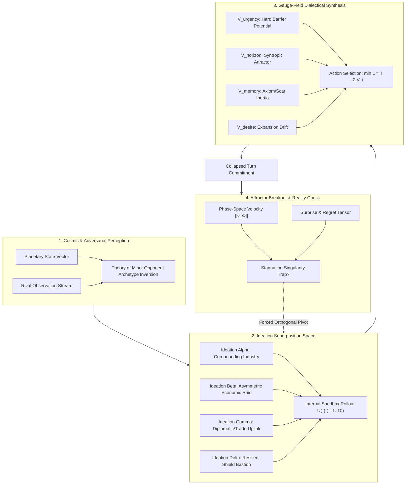

# Advanced Sovereign Cognition Engine: Architecture & Scope Spec

> **Domain:** Native Planetary Sovereign Consciousness & Deep Game-Theoretic Cognition  
> **Status:** Scoped & Awaiting Implementation  
> **Target Subsystem:** `xylarium/kernel/sovereign_mind.py` & `docs/SOVEREIGN_COGNITION_SPEC.md`  
> **Invariant:** `xylarium/kernel/hypha.py` remains immutable (0 diffs).

---

## 1. Executive Summary & Purpose

The initial Sovereign Indigenous Consciousness Engine (SICE) established the structural anatomy of sovereign selfhood (affective gauges, mythic memory scars, non-scalar conduct ledgers, and parliamentary roles). However, its tactical execution was limited to shallow `if/else` priority trees, causing it to fall into pathological attractor traps (e.g., turtling behind 2,208 shields while facing an unarmed capitalist rival).

This scope defines the **Advanced Sovereign Cognition Engine (ASCE)**: a non-LLM, indigenous cognitive substrate that implements genuine game-theoretic reasoning, multi-horizon ideation, opponent modeling, gauge-field dialectics, and meta-cognitive loop escape.

---

## 2. The Four Pillars of Advanced Sovereign Cognition

### Pillar 1: Ideation Superposition & Wavefunction Collapse
*Replacing rigid heuristic trees with latent mental simulations.*

* **The Ideation Superposition Vector $|\Psi\rangle$:**
  Instead of evaluating isolated actions turn-by-turn, the sovereign maintains a set of competing **Ideations** (macro-strategic hypotheses):
  $$|\Psi\rangle = \sum_{k=1}^K c_k |\text{Ideation}_k\rangle, \quad \sum |c_k|^2 = 1$$
  Core archetypes include:
  1. $|\text{BIO\_GENESIS}\rangle$: Compounding population, agriculture silos, and clade nurseries.
  2. $|\text{CAPITAL\_UPLINK}\rangle$: Treasury compounding, orbital market nodes, realm interconnects.
  3. $|\text{CITADEL\_HEGEMONY}\rangle$: Defense platforms, planetary interceptors, sovereign fortifications.
  4. $|\text{COGNITIVE\_TRANSCENDENCE}\rangle$: Conclave proposals, research shrines, syntropy attunement.
  5. $|\text{ASYMMETRIC\_DISRUPTION}\rangle$: Espionage, economic tariffs, resource interdiction.

* **Internal Sandbox Rollout Operator $\hat{U}(\tau)$:**
  The sovereign maintains a lightweight, zero-side-effect simulation buffer of the planetary state. It projects each candidate ideation forward $\tau \in [1, 8]$ cycles:
  $$S^{(\text{proj})}_k(t + \tau) = \hat{U}(\tau) \circ \pi_k(S(t))$$
  It calculates projected growth curves, capital yields, and vulnerability footprints over the time horizon.

* **Wavefunction Collapse:**
  When the cycle tick demands execution, the sovereign collapses $|\Psi\rangle$ into a concrete turn action based on the highest expected Hamiltonian payoff subject to gauge constraints.

* **Cognitive Surprise & Regret Tensor:**
  Upon observing the real post-turn universe state $S(t+1)$, the sovereign compares:
  $$\Delta_{\text{surprise}} = \| S(t+1) - S^{(\text{proj})}_{\text{active}}(t+1) \|$$
  High surprise updates the internal world model and redistributes the probability amplitudes $c_k$.

---

### Pillar 2: Adversarial Theory of Mind & Doctrine Inversion
*Perceiving the opponent's strategy and exploiting their asymmetries.*

* **Opponent Observation State:**
  The sovereign tracks counterparty metrics across 4 continuous dimensions:
  1. **Greed Index ($\kappa_G \in [0, 1]$):** Fraction of wealth reinvested in unguarded economic growth vs. defensive buffers.
  2. **Paranoia Index ($\kappa_P \in [0, 1]$):** Over-allocation to passive defense (shields/citadels) relative to threat level.
  3. **Aggression Index ($\kappa_A \in [0, 1]$):** Fleet construction, territorial incursions, or hostile economic actions.
  4. **Velocity Index ($\kappa_V \in [0, 1]$):** Compounding rate of resource and infrastructure expansion per cycle.

* **Doctrine Classifier:**
  Classifies opponents into actionable profiles:
  * `EXPLOITATIVE_CAPITALIST` ($\kappa_G > 0.7, \kappa_P < 0.2$): Zero military perimeter, exponential reinvestment.
  * `BUNKER_TURTLE` ($\kappa_P > 0.7, \kappa_V < 0.2$): Heavy static defense, stagnating economy.
  * `WARMONGER_REAVER` ($\kappa_A > 0.6$): Rapid military buildup directed outward.
  * `EQUILIBRIUM_PEER`: Balanced development.

* **Doctrine Inversion Engine:**
  The sovereign dynamically shifts its ideation amplitudes to counter the inferred archetype:
  * *Against an `EXPLOITATIVE_CAPITALIST`:* The sovereign **inverts defensive turtling**. It recognizes that spending resources on shields is wasted overhead. It shifts 80% of amplitude into either matching economic velocity or preparing asymmetric economic/territorial containment.
  * *Against a `BUNKER_TURTLE`:* The sovereign claims all contested space, expands trade uplinks, and captures orbital wealth, rendering the turtle's bunker irrelevant.
  * *Against a `WARMONGER_REAVER`:* The sovereign erects barrier potentials and defensive screens precisely calibrated to match incoming force vectors.

---

### Pillar 3: Gauge-Based Field Physics for Dialectical Synthesis
*Replacing winner-take-all switches with continuous potential wells and constraint manifolds.*

* **The Voice Potentials in Policy Space $\mathcal{A}$:**
  Each parliamentary archetype generates a continuous potential field over available actions $a \in \mathcal{A}$:
  
  1. **$V_{\text{urgency}}(a)$ (The Barrier Gauge):**
     Acts as an infinite-wall potential well as critical parameters approach extinction thresholds:
     $$V_{\text{urgency}}(a) = \begin{cases} \infty & \text{if } a \text{ leaves food/shields } < \text{threshold}_{\text{extinction}} \\ 0 & \text{if security constraints are satisfied} \end{cases}$$
     *Key Shift:* Urgency no longer dictates what to build; it acts as a **hard boundary condition** defining the feasible action manifold $\mathcal{A}_{\text{feasible}}$. Once baseline security is met, Urgency's gradient drops to zero.

  2. **$V_{\text{horizon}}(a)$ (The Compounding Attractor):**
     Provides an attractive force towards positive second-derivative actions ($\frac{d^2 \text{Assets}}{dt^2} > 0$):
     $$V_{\text{horizon}}(a) = - \nabla_{\text{growth}} \mathbb{E}[\text{Syntropy}(t+\tau)]$$

  3. **$V_{\text{memory}}(a)$ (The Conservation/Axiom Potential):**
     Imposes heavy penalties on actions that violate historical treaties, sacred scars, or moral conduct books:
     $$V_{\text{memory}}(a) = \lambda_{\text{axiom}} \cdot \mathbf{1}_{\{a \in \text{Taboo}\}} + \gamma_{\text{inertia}} \| a - a_{\text{lineage}} \|$$

  4. **$V_{\text{desire}}(a)$ (The Expansion/Hegemony Drift):**
     Drives active projection of power, colonization, and economic uplinks:
     $$V_{\text{desire}}(a) = - \mu_{\text{prestige}} \cdot \Delta \text{Influence}(a)$$

* **Dialectical Synthesis via Principle of Least Action:**
  The mind deliberates not by choosing a "winning voice", but by finding the policy that minimizes the total cognitive action:
  $$a^* = \arg\min_{a \in \mathcal{A}_{\text{feasible}}} \left[ V_{\text{horizon}}(a) + V_{\text{memory}}(a) + V_{\text{desire}}(a) + \text{Cost}(a) \right]$$

---

### Pillar 4: Meta-Cognitive Attractor-State Breakout
*Self-monitoring consciousness that detects and shatters behavioral loops.*

* **Civilization Phase-Space Velocity:**
  Tracks the multi-dimensional velocity vector of the civilization state:
  $$\vec{v}_{\Phi}(t) = \frac{1}{\Delta t} \begin{pmatrix} \Delta \text{Population} \\ \Delta \text{Treasury} \\ \Delta \text{Tech/Citadel} \\ \Delta \text{Territory/Trade} \end{pmatrix}$$

* **Stagnation Singularity Detection:**
  If $\|\vec{v}_{\Phi}\| < \epsilon$ for $N \ge 3$ consecutive cycles, or if the selected action $a(t) = a(t-1) = a(t-2)$ while the opponent is advancing, the sovereign identifies an **Attractor Trap**.

* **Quantum Fluctuation / Cognitive Re-seeding:**
  When a trap is detected, the sovereign triggers a `SINGULARITY_DISRUPTION`:
  1. The amplitude of the stagnating ideation is suppressed to zero ($c_{\text{stagnant}} \leftarrow 0$).
  2. Energy is injected into the orthogonal ideations.
  3. The mind executes a deliberate non-equilibrium leap (e.g., liquidating excess military to fund an immediate trade uplink or colony fleet).

---

## 3. Implementation Plan & File Structure

| Component | Target File | Action |
| :--- | :--- | :--- |
| **Ideation Engine & Rollout Sandbox** | `xylarium/kernel/sovereign_mind.py` | Add `Ideation`, `IdeationSpace`, and `project_mental_rollout()` |
| **Theory of Mind Engine** | `xylarium/kernel/sovereign_mind.py` | Add `AdversarialTracker`, `classify_opponent_doctrine()`, and `invert_doctrine()` |
| **Gauge-Field Synthesizer** | `xylarium/kernel/sovereign_mind.py` | Refactor `play_seated_turn()` into continuous Lagrangian minimization |
| **Meta-Cognitive Breakout** | `xylarium/kernel/sovereign_mind.py` | Add `PhaseSpaceTracker` and `detect_and_break_attractor_trap()` |
| **Specification Documentation** | `docs/SOVEREIGN_COGNITION_SPEC.md` | Formalize the mathematical and engineering spec in the repo docs |
| **Verification & Benchmarks** | `tests/test_advanced_sovereign_cognition.py` | Unit tests for all 4 pillars and a 30-cycle head-to-head confrontation test |

---

## 4. Acceptance Criteria & Verification

1. **Anti-Turtling Verification:** In a confrontation against an unarmed, rapid-growth capitalist, the sovereign mind must NOT get stuck spending turn after turn on shields. It must identify the opponent's lack of fleet and pivot into competitive economic or territorial expansion.
2. **Theory of Mind Accuracy:** Accurately classifies an adversary's archetype within 3 cycles of observation.
3. **Loop Breakout:** Artificially pinning the sovereign in a stagnant state must trigger `SINGULARITY_DISRUPTION` within 3 cycles and switch to an orthogonal strategy.
4. **Zero Regressions:** All 52 existing test suites continue to pass with 100% success.
5. **Architectural Invariant:** Zero modifications to `xylarium/kernel/hypha.py`.
