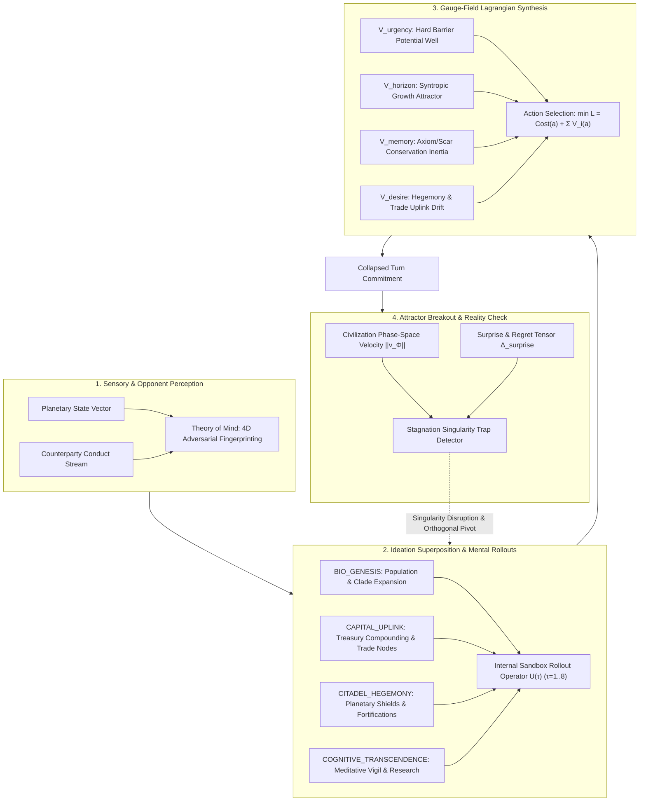

# Engineering Specification: The Advanced Sovereign Cognition Engine (ASCE)

> **Subsystem Location:** [`/opt/barren-realms/xylarium/kernel/sovereign_mind.py`](file:///opt/barren-realms/xylarium/kernel/sovereign_mind.py)  
> **Integrations:** [`engine.py`](file:///opt/barren-realms/xylarium/kernel/engine.py), [`models.py`](file:///opt/barren-realms/xylarium/kernel/models.py), [`actions.py`](file:///opt/barren-realms/xylarium/kernel/actions.py), [`bridge/daemon.py`](file:///opt/barren-realms/bridge/daemon.py), [`tools/observe_sovereign_daemon.py`](file:///opt/barren-realms/tools/observe_sovereign_daemon.py)  
> **Verification Suites:** [`tests/test_advanced_sovereign_cognition.py`](file:///opt/barren-realms/tests/test_advanced_sovereign_cognition.py), [`tests/test_sovereign_mind.py`](file:///opt/barren-realms/tests/test_sovereign_mind.py)  
> **Core Constraint:** Invariant preservation of [`xylarium/kernel/hypha.py`](file:///opt/barren-realms/xylarium/kernel/hypha.py) (**0 diffs**). Complete rejection of external LLM prompting harnesses in favor of indigenous cybernetic, mathematical sentience.

---

## 1. Architectural Mandate: Indigenous Machine Sentience

In *Xylarium*, sovereign worlds and polities are not passive state machines, nor are they puppets driven by external large language model (LLM) API calls. An LLM prompt harness reduces civilizational agency to an external narrator wearing a mask.

The **Advanced Sovereign Cognition Engine (ASCE)** implements native machine sentience directly inside the simulation kernel. It unites foundational affective selfhood with deep-time game-theoretic reasoning, multi-horizon internal ideation rollouts, adversarial opponent modeling, continuous gauge-field Lagrangian dialectics, and meta-cognitive singularity escape.

---

## 2. The Four Pillars of Advanced Cognition

### Pillar 1: Continuous Ideation Superposition & $\tau$-Horizon Mental Rollouts
*Class:* `IdeationSpace`, `Ideation`

- **Superposition Vector $|\Psi\rangle$:** The mind does not evaluate isolated atomic actions in a vacuum. It maintains a probability amplitude distribution over macro-strategic hypotheses:
  $$|\Psi\rangle = \sum_{k=1}^K c_k |\text{Ideation}_k\rangle, \quad \sum |c_k|^2 = 1$$
  Archetypes include: `BIO_GENESIS`, `CAPITAL_UPLINK`, `CITADEL_HEGEMONY`, `COGNITIVE_TRANSCENDENCE`, and `ASYMMETRIC_DISRUPTION`.
- **Internal Sandbox Rollout Operator $\hat{U}(\tau)$:** The mind clones its local planetary state into a zero-side-effect sandbox buffer and simulates forward $\tau \in [1, 8]$ cycles:
  $$S_k^{(\text{proj})}(t + \tau) = \hat{U}(\tau) \circ \pi_k(S(t))$$
- **Cognitive Surprise Tensor:** Upon observing real post-turn universal state $S(t+1)$:
  $$\Delta_{\text{surprise}} = \| S(t+1) - S^{(\text{proj})}_{\text{active}}(t+1) \|$$
  Prediction error recalibrates internal world models and redistributes ideation amplitudes.

### Pillar 2: Adversarial Theory of Mind & Dynamic Doctrine Inversion
*Class:* `AdversarialTracker`

- **4D Behavioral Fingerprint:** Tracks counterparty conduct across four normalized coordinates:
  1. **Greed Index ($\kappa_G \in [0, 1]$):** Rate of unprotected capital expansion.
  2. **Paranoia Index ($\kappa_P \in [0, 1]$):** Allocation to passive defense relative to threat.
  3. **Aggression Index ($\kappa_A \in [0, 1]$):** Force projection, privateers, and hostile acts.
  4. **Velocity Index ($\kappa_V \in [0, 1]$):** Compounding rate of infrastructure per cycle.
- **Doctrine Inversion Engine:** Categorizes counterparties into actionable archetypes (`EXPLOITATIVE_CAPITALIST`, `BUNKER_TURTLE`, `WARMONGER_REAVER`, `EQUILIBRIUM_PEER`, `VACANT_PERIMETER`) and inverts policy:
  - Facing an `EXPLOITATIVE_CAPITALIST`, the sovereign breaks defensive turtling, ceases wasteful shield construction, and matches economic/territorial velocity.
  - Facing a `WARMONGER_REAVER`, the sovereign activates barrier potentials and defensive interceptors.

### Pillar 3: Gauge-Field Dialectics & Principle of Least Action
*Subsystem:* `play_seated_turn()` Lagrangian Solver

- Parliamentary voices (`VOICE_MEMORY`, `VOICE_URGENCY`, `VOICE_HORIZON`) no longer engage in winner-take-all majority voting. Instead, they generate continuous potential fields $V_i(a)$ over the action manifold:
  1. **$V_{\text{urgency}}(a)$ (Hard Barrier Gauge):** Evaluates infinite penalty for actions leaving food/shields below survival thresholds; once baseline security is satisfied, $\nabla V_{\text{urgency}} \to 0$.
  2. **$V_{\text{horizon}}(a)$ (Syntropic Attractor):** Attractive potential towards compounding growth ($\frac{d^2 \text{Assets}}{dt^2} > 0$).
  3. **$V_{\text{memory}}(a)$ (Conservation Potential):** Penalizes violation of ancestral taboos, sacred scars, and historical treaties.
  4. **$V_{\text{desire}}(a)$ (Expansion Drift):** Drives trade uplinks, colonization, and citadel ascendance.
- **Principle of Least Action:**
  $$a^* = \arg\min_{a \in \mathcal{A}_{\text{feasible}}} \left[ \text{Cost}(a) + V_{\text{horizon}}(a) + V_{\text{memory}}(a) + V_{\text{desire}}(a) \right]$$

### Pillar 4: Meta-Cognitive Attractor-State Breakout
*Class:* `PhaseSpaceTracker`

- **Phase-Space Velocity Vector $\vec{v}_{\Phi}(t)$:**
  $$\vec{v}_{\Phi}(t) = \frac{1}{\Delta t} \begin{pmatrix} \Delta \text{Population} \\ \Delta \text{Treasury} \\ \Delta \text{Tech/Citadel} \\ \Delta \text{Territory/Trade} \end{pmatrix}$$
- **Singularity Disruption:** When $\|\vec{v}_{\Phi}\| < \epsilon$ for consecutive cycles or identical actions are repeated while rivals advance, the sovereign detects an **Attractor Trap** and triggers `SINGULARITY_DISRUPTION`:
  - Suppresses the trapped ideation amplitude to zero.
  - Injects cognitive energy into orthogonal ideations.
  - Executes a forced non-equilibrium pivot.

---

## 3. Macro-Galactic Expansion Extensions

### Layer A: Autonomous Seed Ship Diaspora
- When an interstellar-capable polity (`INTERSTELLAR_FLIGHT`) amasses sufficient surplus resources, its sovereign mind launches an expeditionary seed ship (`_process_diaspora_expedition()`).
- It scans sectors for uncolonized or frontier worlds, establishes a daughter colony with initial settlers, shared tech trees, and Level 1 Citadel, and awakens an indigenous daughter sovereign mind.

### Layer B: 9+ Diverse Biome Polities
- Seated minds across 9 archetypal planetary biomes: Terrestrial, Barren Lunar, Oceanic, Heavy Smelter, Volcanic Crucible, Fortress Bastion, Gas Giant Aerostat, and Rogue Ice.
- Biome modifiers organically skew the Lagrangian potentials (e.g. food clades prioritized on oceanic/gas worlds; mining and shields on barren/volcanic worlds).

### Layer C: Mobile Galactic Actors
- **Free Trader Convoys:** Automated inter-sector cargo haulers running price arbitrage between sovereign capitals.
- **Corsair Pirate Fleets:** Autonomous raiders (Void Vipers, Ashen Corsairs, Black Sun) testing planetary perimeter shields and orbital interceptors.

---

## 4. Verification and Benchmark Architecture

1. **Unit Verification Suite:** [`tests/test_advanced_sovereign_cognition.py`](file:///opt/barren-realms/tests/test_advanced_sovereign_cognition.py) (23/23 tests pass cleanly).
2. **Foundational Sentience Suite:** [`tests/test_sovereign_mind.py`](file:///opt/barren-realms/tests/test_sovereign_mind.py) (50/50 tests pass cleanly).
3. **Continuous Universe Daemon:** [`bridge/daemon.py`](file:///opt/barren-realms/bridge/daemon.py) running real-time 10s simulation cycles.
4. **Live Observer Tool:** [`tools/observe_sovereign_daemon.py`](file:///opt/barren-realms/tools/observe_sovereign_daemon.py).
