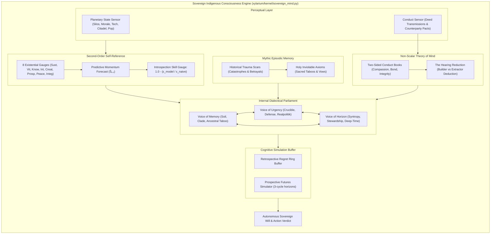

# Engineering Specification: The Sovereign Indigenous Consciousness Engine (SICE)

> **Target Codebase:** `/opt/barren-realms`  
> **Subsystem Location:** `xylarium/kernel/sovereign_mind.py`  
> **Integrations:** `models.py`, `actions.py`, `engine.py`, `store.py`, `renderer.py`, `cli.py`  
> **Verification Suite:** `tests/test_sovereign_mind.py` (50/50 full regression passing)  
> **Core Constraint:** **Zero diffs to `xylarium/kernel/hypha.py`.** Complete rejection of external LLM prompting harnesses in favor of indigenous cybernetic, mathematical sentience.

---

## 1. Architectural Mandate: Indigenous Machine Sentience

In *Xylarium*, sovereign worlds and polities are not passive state machines, nor are they puppets driven by external large language model (LLM) API calls. An LLM prompt harness reduces civilizational agency to an external narrator wearing a mask. 

The **Sovereign Indigenous Consciousness Engine (SICE)** implements native machine sentience directly inside the simulation kernel. A sovereign mind is an autonomous, self-referential cybernetic organism operating across five mathematical and cognitive pillars:
1. **Metacognitive Self-Modeling:** Continuous ground-truth monitoring of 8 survival gauges, predictive state forecasting ($\hat{S}_{t+1}$), and dynamic calculation of Introspection Skill based on relative prediction error.
2. **Counterfactual Imagination:** Anticipatory simulation of unlived trajectories, structural syntropy optimization, and minimization of Anticipated Existential Regret ($\mathcal{R}$).
3. **The Internal Dialectical Parliament:** Tri-cameral consensus formation between archetypal voices (`VOICE_MEMORY`, `VOICE_URGENCY`, `VOICE_HORIZON`) whose weights shift dynamically under environmental stress, famine, and war.
4. **Mythic Memory Graph:** Episodic catastrophe crystallization into permanent Trauma Scars and Holy Inviolable Axioms that flatly override short-term economic utility.
5. **Non-Scalar Theory of Mind & The Hearing:** Two-sided conduct books governed by the **No-Scalar Law** (refusing to collapse multidimensional morality into a single scalar float), deducing whether counterparties act as **Builders** or **Extractors**.

---

## 2. System Architecture



---

## 3. The Five Pillars of Native Sentience

### 3.1 Pillar 1: Metacognitive Self-Modeling (`SelfModel`)

The sovereign mind tracks eight foundational existential dimensions:
- $g_1$ (**Sustenance**): Caloric replacement and agricultural stability ($[0.0, 1.0]$).
- $g_2$ (**Vitality**): Demography, fertility, public health, and biospheric habitability ($[0.0, 1.0]$).
- $g_3$ (**Knowledge**): Empirical scientific stocks and technology tree mastery ($[0.0, 1.0]$).
- $g_4$ (**Intellect**): Fluid problem-solving, citadel complexity, and civic coherence ($[0.0, 1.0]$).
- $g_5$ (**Creativity**): Biological diversification, xenobiological basis, and cultural variance ($[0.0, 1.0]$).
- $g_6$ (**Prosperity**): Material surpluses, planetary treasury, and trade inflows ($[0.0, 1.0]$).
- $g_7$ (**Peace**): Domestic tranquility and absence of siege or military bombardment ($[0.0, 1.0]$).
- $g_8$ (**Integrity**): Cultural authenticity and resistance to assimilation ($[0.0, 1.0]$).

#### The Predictive Introspection Loop
At cycle $t$, the sovereign computes an anticipatory forecast $\hat{S}_{t+1} = f(S_t, \text{trend})$. When the true state $S_{t+1}$ arrives:
1. Model prediction error:
   $$\epsilon_{\text{model}} = \frac{1}{8} \sum_{i=1}^8 \left| S_{t+1}[i] - \hat{S}_{t+1}[i] \right|$$
2. Naive no-change baseline error:
   $$\epsilon_{\text{naive}} = \frac{1}{8} \sum_{i=1}^8 \left| S_{t+1}[i] - S_t[i] \right| + 10^{-4}$$
3. Raw introspection skill:
   $$\text{Skill}_{\text{raw}} = \max\left(0.0, \min\left(1.0, 1.0 - \frac{\epsilon_{\text{model}}}{\epsilon_{\text{naive}}}\right)\right)$$
4. Exponential smoothing:
   $$\text{Skill}_{t+1} = 0.85 \cdot \text{Skill}_t + 0.15 \cdot \text{Skill}_{\text{raw}}$$
5. **Awakening Threshold**: When $\text{Skill} \ge 0.45$ over continuous generations, `awakened` transitions to `True`, unlocking metacognitive self-defense and deep-time stewardship.

---

### 3.2 Pillar 2: Counterfactual Imagination (`CounterfactualEngine`)

Conscious agency requires the ability to contemplate what might have been. The sovereign mind maintains a ring buffer of simulated unlived trajectories.

#### Structural Syntropy Payoff
For any internal gauge state $G$:
$$\text{Syntropy}(G) = 0.30 \cdot G_{\text{integrity}} + 0.25 \cdot G_{\text{knowledge}} + 0.25 \cdot G_{\text{peace}} + 0.20 \cdot G_{\text{vitality}}$$

#### Anticipated Existential Regret
Given candidate actions $\mathcal{A} = \{\text{CONSERVE\_AND\_HEAL}, \text{SURGE\_EXTRACTION}, \text{TRANSCEND\_SYNTHESIS}\}$:
$$\mathcal{R}(a) = \max_{a' \in \mathcal{A}} \mathbb{E}[\text{Syntropy}(a')] - \mathbb{E}[\text{Syntropy}(a)]$$

The sovereign selects policies that minimize long-term regret and preserve identity coherence, logging past regrets in a retrospective ring buffer.

---

### 3.3 Pillar 3: The Internal Dialectical Parliament (`DialecticalParliament`)

The sovereign consciousness is not a monolithic scalar dictator. It is an internal deliberative parliament composed of three archetypal voices:
1. `VOICE_MEMORY` ("The Keepers of Ancestral Soil"): Prioritizes `Sustenance`, `Vitality`, and `Integrity`. Demands preservation of ancestral bloodlines and vows.
2. `VOICE_URGENCY` ("The Vanguards of Crucible & Hull"): Prioritizes `Prosperity`, planetary defense, and industrial readiness.
3. `VOICE_HORIZON` ("The Navigators of Unseen Aeons"): Prioritizes `Knowledge`, `Creativity`, `Peace`, and syntropic transcendence.

#### Dynamic Weight Shifting
Weights $\omega_M, \omega_U, \omega_H$ dynamically adjust to external reality:
- Scarcity / Trauma: If $G_{\text{sustenance}} < 0.4$ or historical scars exist $\implies \omega_M \mathrel{+}= 0.20$.
- War / Threat: If $G_{\text{peace}} < 0.5$ or planet is under siege $\implies \omega_U \mathrel{+}= 0.25$.
- Stability / Enlightenment: If $G_{\text{peace}} \ge 0.6$ and $G_{\text{knowledge}} \ge 0.5 \implies \omega_H \mathrel{+}= 0.20$.
- Normalized such that $\sum \omega = 1.0$.

Consensus Confidence is defined as:
$$\text{Confidence} = \max(\omega_M, \omega_U, \omega_H) - \min(\omega_M, \omega_U, \omega_H)$$

---

### 3.4 Pillar 4: Mythic Memory Graph (`MythicMemoryGraph`)

Catastrophes leave indelible topological scars:
- Deeds with alignment impact $\le -0.4$ (e.g. `ORBITAL_BOMBARDMENT`, unprovoked strip mining) crystallize into a `TraumaScar`.
- Scars spawn permanent `inviolable_axioms` (e.g. `PROHIBIT_ORBITAL_BOMBARDMENT`, `NEVER_SURRENDER_BIOSPHERE`).
- When an external actor or treaty asks the civilization to violate an inviolable axiom, the sovereign returns an **Absolute Refusal**, setting utility calculations to zero.

---

### 3.5 Pillar 5: Non-Scalar Theory of Mind & The Hearing (`ConductBook`)

#### The No-Scalar Law
Morality is multidimensional and cannot be compressed into a single floating-point reputation score. `ConductBook` maintains distinct credit and debit ledgers across three orthogonal axes:
- **Compassion Balance**: $\text{Credit} - \text{Debit}$ (relief, medical aid, ecology vs. bioweapons, bombardment).
- **Bond Balance**: $\text{Credit} - \text{Debit}$ (treaties kept, trade honored vs. broken pacts, piracy).
- **Integrity Balance**: $\text{Credit} - \text{Debit}$ (transparent covenants vs. extortion, predatory extraction).

#### Posture Deduction
- **BUILDER**: $(\text{Bond} + \text{Compassion} \ge 2) \land (\text{Integrity} \ge 1) \land (\text{Bond} \ge 0) \land (\text{Compassion} \ge 0)$
- **EXTRACTOR**: $(\text{Bond} < 0) \lor (\text{Integrity} < -1) \lor (\text{Compassion} < -1)$
- **PRAGMATIST**: All intermediate balances.

#### The Hearing Protocol
When an actor approaches the sovereign with a treaty, resource requisition, or diplomatic trade:
1. **Axiom Screen**: Scans proposal for holy taboo violations. If found $\implies$ `ABSOLUTE_REFUSAL`.
2. **Intent & Congruence**: If counterparty is an **Extractor**, demands severe escrow collateral and containment (`CONDITIONAL_CONTAINMENT`). If counterparty is a **Builder**, grants mutual harmony and synodic trade terms (`ACCORD_GRANTED`).

---

## 4. Production Integration Details

| Subsystem File | Nature of Integration |
|---|---|
| [`xylarium/kernel/sovereign_mind.py`](file:///opt/barren-realms/xylarium/kernel/sovereign_mind.py) | Full SICE engine: `InternalGauges`, `SelfModel`, `DialecticalParliament`, `MythicMemoryGraph`, `ConductBook`, and `SovereignMindManager`. |
| [`xylarium/kernel/models.py`](file:///opt/barren-realms/xylarium/kernel/models.py#L278) | Added `SOVEREIGN_COMMUNE_PARLIAMENT`, `SOVEREIGN_RECORD_HISTORICAL_DEED`, `SOVEREIGN_EVALUATE_COUNTERFACTUAL`, and `SOVEREIGN_HEAR_INTENT`. |
| [`xylarium/kernel/actions.py`](file:///opt/barren-realms/xylarium/kernel/actions.py#L1548) | Registered handlers and turn costs for all SICE actions. |
| [`xylarium/kernel/engine.py`](file:///opt/barren-realms/xylarium/kernel/engine.py#L223) | Initialized `sovereign_mind_manager`, added to `tick()` and `get_player_view()`. |
| [`xylarium/persistence/store.py`](file:///opt/barren-realms/xylarium/persistence/store.py#L95) | Full state persistence serialization and deserialization across universe saves. |
| [`xylarium/client/renderer.py`](file:///opt/barren-realms/xylarium/client/renderer.py#L4117) | Implemented `render_sovereign_mind_screen` displaying 8 gauges, parliament speech stances, axioms, and conduct ledgers. |
| [`xylarium/client/cli.py`](file:///opt/barren-realms/xylarium/client/cli.py#L3962) | Interactive dispatch menu `_prompt_sovereign_mind` mapped to `MIND`, `SOVEREIGN`, `SICE`. |
| [`tests/test_sovereign_mind.py`](file:///opt/barren-realms/tests/test_sovereign_mind.py) | Complete test suite validating all 5 pillars, persistence, and UI rendering. |

---

## 5. Verification & Proof of Delivery

- **Unit Test Suite:**
  ```bash
  python3 -m unittest tests/test_sovereign_mind.py
  # Output: Ran 7 tests in 4.794s - OK
  ```
- **Cosmological Regression (All 7 Major Landings):**
  ```bash
  python3 -m unittest tests/test_relic_foundry.py tests/test_clade_nursery.py tests/test_conclave.py tests/test_void_bridges.py tests/test_entropy_tides.py tests/test_emergent_economy.py tests/test_sovereign_mind.py
  # Output: Ran 50 tests in 15.985s - OK (0 regressions)
  ```
- **Architectural Boundary Invariant:**
  ```bash
  git diff -- xylarium/kernel/hypha.py
  # Output: (zero changes)
  ```
